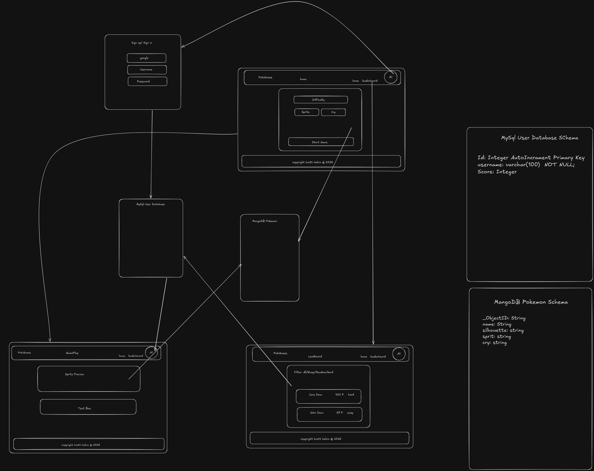

# PokiGuess

---



## What is it
PokiGuess is a Guess Who game where you are given a Pokémon's silhouette or cry and have to guess its name.
You are given three guesses, and each guess is worth a different amount of points:
- **First guess:** 5 points
- **Second guess:** 3 points
- **Third guess:** 1 point

---

## Tech Stack

### Front End
- htmx
- Java Thymeleaf

### Back End
- Java Spring Boot
- Docker for DB hosting
  - mysql for users
  - MongoDB for Pokémon storage

---

## Run
From the root of the project, run:
```bash
docker compose up --build --force-recreate -d
```
---

## Requirements

### Week One: Skeleton
- [ ] Set up project
  - [ ] File structure
  - [ ] Add to GitHub
- [ ] Set basic UI elements for the four pages:
  - [ ] Sign-in page 
  - [ ] Start page
  - [ ] Game page
  - [ ] Leaderboard

### Week Two: Users
- [ ] Set up authentication for user accounts
- [ ] User database setup

### Week Three: Core Development
- [ ] Pokémon database setup

### Week Four: Hosting
- [ ] Set up hosting on Azure

### Week Five: Final Touches
- [ ] Testing endpoints
- [ ] Final polishing
